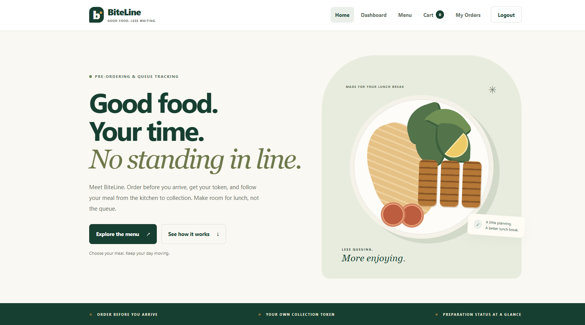
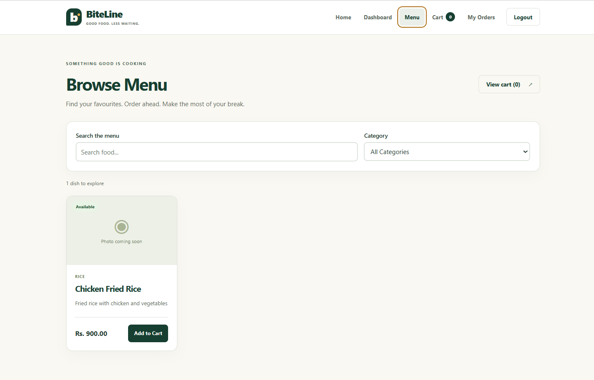
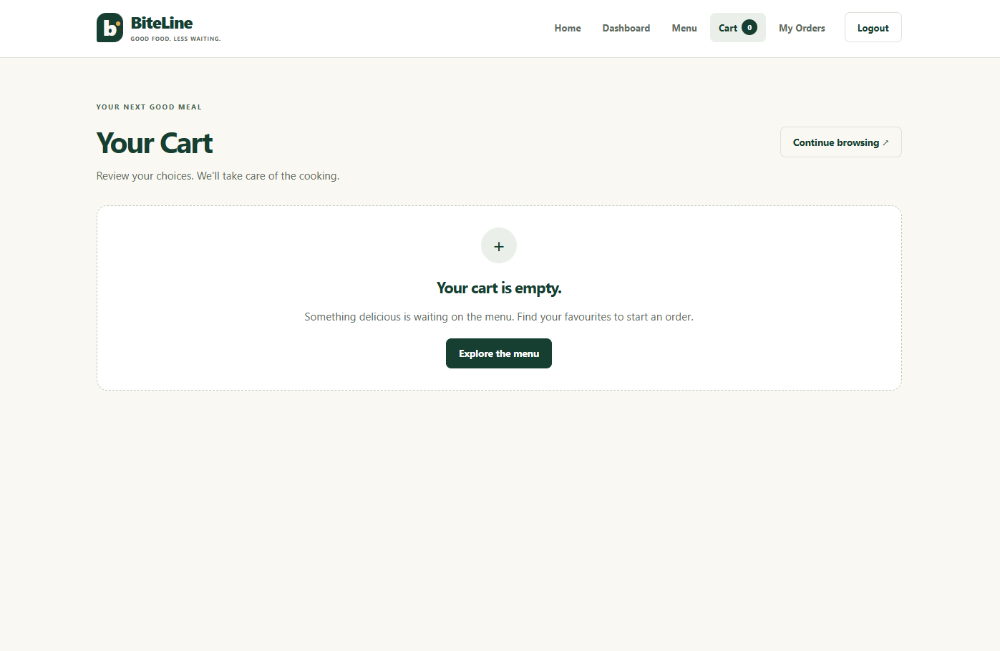
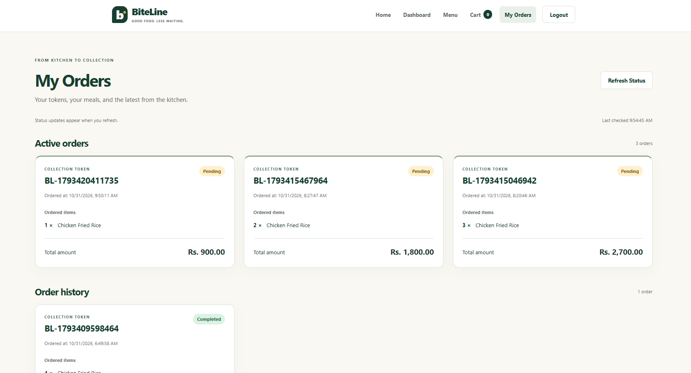
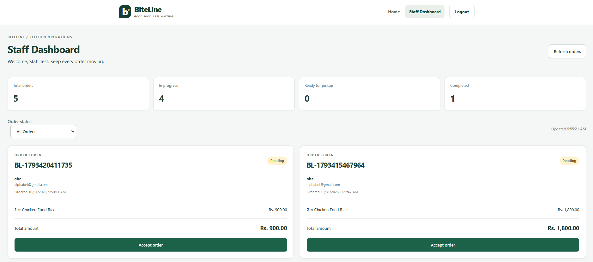
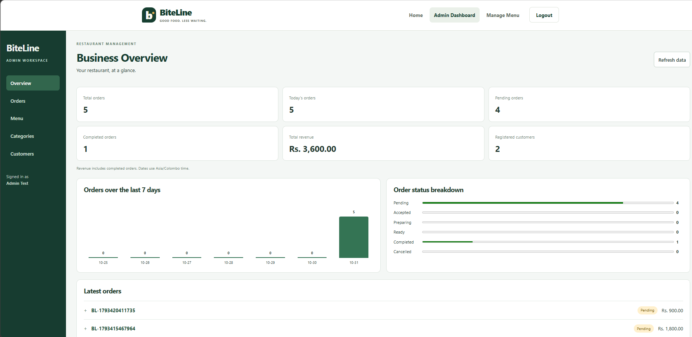

# BiteLine

BiteLine is a restaurant pre-ordering and queue-tracking web application designed to reduce physical waiting time when ordering food.

Customers can browse the restaurant menu, add food items to a cart, place an order before arriving, receive a unique collection token, and track the preparation status of their order.

The system also provides separate dashboards for restaurant staff and administrators.

## Project Overview

BiteLine provides a complete food pre-ordering workflow with three main user roles:

- Customer
- Staff
- Admin

Customers can place and track orders.

Staff can view incoming orders and update preparation status.

Admins can manage menu items, categories, customers, orders, and dashboard information.

## Problem Statement

Traditional restaurant ordering can create long queues, especially during busy periods.

Customers may spend unnecessary time waiting to place an order and waiting again for food preparation.

BiteLine reduces this problem by allowing customers to order in advance and track their order using a collection token.

## Solution

BiteLine allows customers to:

1. Register and log in.
2. Browse available menu items.
3. Search and filter food by category.
4. Add food items to a cart.
5. Update quantities.
6. Place an order.
7. Receive a unique collection token.
8. Track the preparation status of the order.
9. Collect the food when the order is ready.

## Main Features

### Customer Features

- Customer registration and login
- Browse menu items
- Search menu items
- Filter by category
- Add items to cart
- Increase and decrease quantity
- Remove items from cart
- Checkout and place orders
- Receive a collection token
- View order history
- Track order status
- Responsive mobile interface

### Staff Features

- Staff login
- View incoming customer orders
- View order details
- View customer and item information
- Update order status
- Manage the preparation workflow

Order status flow:

```text
Pending
→ Accepted
→ Preparing
→ Ready
→ Completed
```

### Admin Features

- Admin login
- Dashboard overview
- View orders
- Search orders
- View customers
- View customer order history
- Manage food categories
- Add, edit and delete menu items
- Change menu item availability
- View order statistics
- View completed-order revenue

## User Roles

### Customer

Customers can browse the menu, manage the cart, place orders and track their own orders.

### Staff

Staff members can view customer orders and update the preparation status of each order.

### Admin

Administrators can manage restaurant data including categories, menu items, customers and orders.

## Technology Stack

### Frontend

- React
- Vite
- React Router
- Axios
- CSS

### Backend

- Node.js
- Express.js

### Database

- MongoDB
- Mongoose

### Authentication and Security

- JSON Web Token (JWT)
- bcrypt password hashing
- Role-based authorization

### Testing

- Node.js built-in test runner
- Browser-based tests
- Real MongoDB integration tests
- Chrome browser end-to-end testing

## System Architecture

BiteLine follows a client-server architecture.

```text
React Frontend
      |
      | HTTP / REST API
      v
Node.js + Express Backend
      |
      | Mongoose
      v
MongoDB Database
```

### Frontend

The frontend is responsible for:

- User interface
- Navigation
- Authentication state
- Cart state
- Sending API requests
- Displaying menu data
- Displaying order status
- Role-based dashboards

### Backend

The backend is responsible for:

- API endpoints
- User authentication
- Role-based authorization
- Business logic
- Order processing
- Menu and category management
- Database communication

### Database

MongoDB stores the application data using Mongoose models.

## Database Models

### User

Stores information about registered users.

Main fields:

- Name
- Email
- Password
- Role
- Created date
- Updated date

Supported roles:

- Customer
- Staff
- Admin

Passwords are stored as hashes rather than plain-text passwords.

### Category

Stores menu categories.

Main fields:

- Category name
- Description
- Created date
- Updated date

### MenuItem

Stores restaurant menu items.

Main fields:

- Name
- Description
- Price
- Category
- Image
- Availability

### Order

Stores customer orders.

Main fields:

- Customer reference
- Ordered items
- Item quantities
- Total amount
- Collection token
- Order status
- Created date
- Updated date

Supported order statuses:

```text
pending
accepted
preparing
ready
completed
cancelled
```

## API Overview

BiteLine uses REST API endpoints for communication between the frontend and backend.

### Authentication

```text
POST /api/auth/register
POST /api/auth/login
GET  /api/auth/me
```

### Categories

```text
GET    /api/categories
POST   /api/categories
PUT    /api/categories/:id
DELETE /api/categories/:id
```

Administrative operations are protected by role-based authorization.

### Menu

```text
GET    /api/menu
GET    /api/menu/:id
POST   /api/menu
PUT    /api/menu/:id
DELETE /api/menu/:id
```

### Orders

```text
POST /api/orders
GET  /api/orders/my-orders
GET  /api/orders
PUT  /api/orders/:id/status
```

Customers can create and view their own orders.

Staff and administrators can retrieve restaurant orders and update order status.

### Customers

```text
GET /api/customers
```

Customer management information is available only to administrators.

## Installation and Setup

### Prerequisites

Install the following before running the project:

- Node.js
- npm
- MongoDB or MongoDB Atlas
- Git

### Clone the Repository

```bash
git clone <your-repository-url>
cd BiteLine
```

### Backend Setup

Open a terminal:

```bash
cd backend
npm install
```

Create a `.env` file inside the `backend` folder.

Example:

```env
PORT=5000
MONGO_URI=your_mongodb_connection_string
JWT_SECRET=your_jwt_secret
```

Do not commit the `.env` file to GitHub.

Start the backend:

```bash
npm run dev
```

The backend runs on:

```text
http://localhost:5000
```

### Frontend Setup

Open another terminal:

```bash
cd frontend
npm install
npm run dev
```

The frontend normally runs on:

```text
http://localhost:5173
```

Open this address in a browser.

## Environment Variables

The backend requires environment variables for database connectivity and authentication.

```env
PORT=
MONGO_URI=
JWT_SECRET=
```

Sensitive values such as MongoDB credentials and JWT secrets must never be stored directly in source code.

## How to Run the Application

Use two terminals.

### Terminal 1 — Backend

```bash
cd backend
npm run dev
```

### Terminal 2 — Frontend

```bash
cd frontend
npm run dev
```

Then open:

```text
http://localhost:5173
```

## Screenshots

### Home Page



### Customer Menu



### Order Confirmation



### Customer Order Tracking



### Staff Dashboard



### Admin Dashboard



## Testing

BiteLine was tested at multiple levels to verify frontend behaviour, backend functionality, database integration and role-based workflows.

### Test Coverage

The project includes:

- Frontend tests
- Backend tests
- MongoDB integration tests
- Browser-based end-to-end tests
- Responsive layout tests
- Role-based authorization tests

### Verified Workflows

The following workflows were tested successfully:

#### Customer

```text
Register
→ Login
→ Browse Menu
→ Search / Filter
→ Add to Cart
→ Update Quantity
→ Checkout
→ Receive Collection Token
→ View My Orders
→ Track Order Status
```

#### Staff

```text
Login
→ View Incoming Orders
→ View Order Details
→ Accept Order
→ Preparing
→ Ready
→ Completed
```

#### Admin

```text
Login
→ View Dashboard
→ Manage Categories
→ Manage Menu Items
→ View Customers
→ View Orders
→ Verify Statistics
```

### Validation Results

The project successfully passed:

- Backend mocked tests
- Integration isolation checks
- Real MongoDB integration scenarios
- Frontend tests
- Browser-based role tests
- Production build
- Lint checks

The application was also verified using the actual Express backend and MongoDB database without mocking API responses in the final role-based browser tests.

## Security Features

BiteLine includes several security mechanisms:

- Password hashing using bcrypt
- JWT-based authentication
- Role-based authorization
- Protected frontend routes
- Protected backend API endpoints
- Database-backed role verification
- Restricted customer data access
- Environment variables for sensitive configuration

Users are assigned one of three roles:

```text
customer
staff
admin
```

Each role can access only the functionality intended for that role.

## System Workflow

The main BiteLine workflow is:

```text
Customer
   ↓
Browse Menu
   ↓
Add Items to Cart
   ↓
Checkout
   ↓
Order Created
   ↓
Collection Token Generated
   ↓
Staff Receives Order
   ↓
Pending
   ↓
Accepted
   ↓
Preparing
   ↓
Ready
   ↓
Completed
   ↓
Customer Collects Order
```

Customers can refresh My Orders to view the latest preparation status.

## Known Limitations

The current version of BiteLine has the following limitations:

- Order status updates are refreshed manually by the customer.
- Real-time WebSocket notifications are not implemented.
- Online payment processing is not included.
- Staff account management is not included in the current Admin interface.
- Queue-position and estimated waiting-time calculations are not implemented.
- Advanced concurrency testing was outside the scope of this academic project.

These limitations do not affect the core ordering and queue-tracking workflow.

## Future Improvements

Possible future improvements include:

- Real-time order updates using WebSockets
- Push notifications when an order is ready
- Online payment integration
- Estimated preparation time
- Queue position calculation
- Staff account management
- Sales reports and advanced analytics
- Food image upload support
- Deployment to a production cloud environment

## Project Purpose

BiteLine was developed as an academic full-stack software project to demonstrate understanding of:

- Frontend development
- Backend development
- REST APIs
- Database integration
- Authentication
- Authorization
- CRUD operations
- Responsive design
- Software testing

## Contributors

Developed as part of a university software development project.